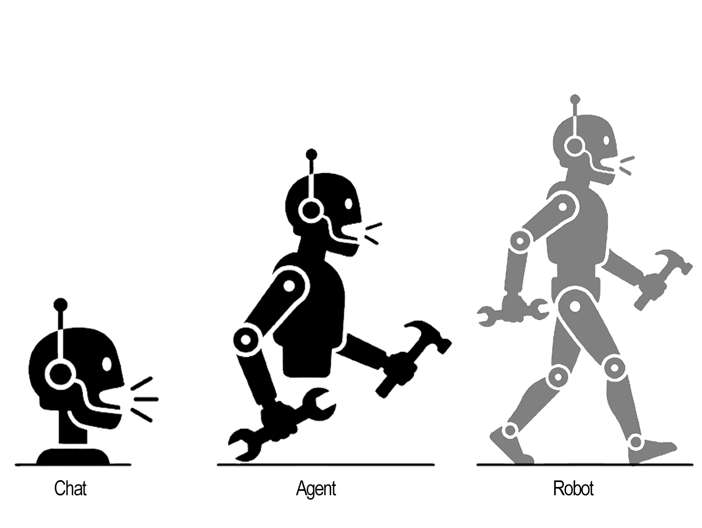

# AI Era Learning Path

> **LangChain, LangGraph & Machine Learning — Start Building AI Applications in One Day**

AI is changing how we build software, opening up new possibilities for developers.

To build AI applications, you'll eventually need to understand concepts from machine learning, deep learning, and other areas of AI. Learning all of these from scratch takes considerable time and effort.

**The good news? You don't have to learn everything before you start building.**

Over the years, developers have built a mature ecosystem of frameworks, libraries, and tools that make AI application development much more accessible. By learning how to use these tools, you can start building practical AI applications while gradually developing a deeper understanding of the underlying concepts.

That's what this learning path is about: helping you get up to speed with the essential knowledge and tools of the AI era, without getting lost in scattered documentation.

This repository contains **three hands-on courses** covering LangChain, LangGraph, and Machine Learning. Each course introduces key concepts through practical, runnable examples that you can explore at your own pace.

Every example is a standalone script. Open it, read the comments, and run it yourself. Learn by doing, one example at a time.

<div align="center">

</div>

## Characteristics

- **Modern Python project** — Dependency management, virtual environments, and packaging handled by [uv](https://github.com/astral-sh/uv).
- **Python best practices** — Type hints, docstrings, clean imports, and consistent code style enforced by Ruff.
- **LangChain, LangGraph & LangSmith** — Progressive examples, from basic model invocation to advanced agent workflows and multi-agent orchestration.
- **Learn by doing** — Every example is runnable, with detailed comments explaining not just what the code does, but why.
- **A structured learning path** — Learn the essential tools and concepts without having to piece everything together from scattered documentation.
- **OpenAI-compatible API** — The examples use the OpenAI-compatible API format, so you can run them with a wide range of LLM providers. If OpenAI's services aren't available in your region, you can use another provider that supports the same API format. Simply configure your API key, model name, and base URL to get started.

## Quick Start

Install the dependencies:

```bash
uv sync
```

Run an example:

```bash
uv run src/course1/001agent.py
```

Before running the examples, create a `.env` file with your model provider's configuration:

```dotenv
# OpenAI-compatible API
API_KEY=your_api_key
LLM_MODEL=your_model_name
LLM_MODEL2=your_advanced_model_name
BASE_URL=your_api_base_url
```

Replace the placeholder values with the credentials and model names provided by your chosen API provider.

## Course List

| Course | Source | Topics |
|---|---|---|
| LangChain Crash Course | [src/course1](src/course1) | Model invocation, chat, streaming, agents and tools, multimodal inputs (images), embeddings, RAG, middleware (hooks, dynamic prompts, model routing), prompt templates, LCEL, output parsing, document loaders and splitters, callbacks, and caching |
| LangGraph Crash Course | [src/course2](src/course2) | StateGraph, conditional routing, multi-agent workflows, and tool integration |
| Machine Learning Crash Course | [src/course3](src/course3) | Practical machine learning and data analysis |